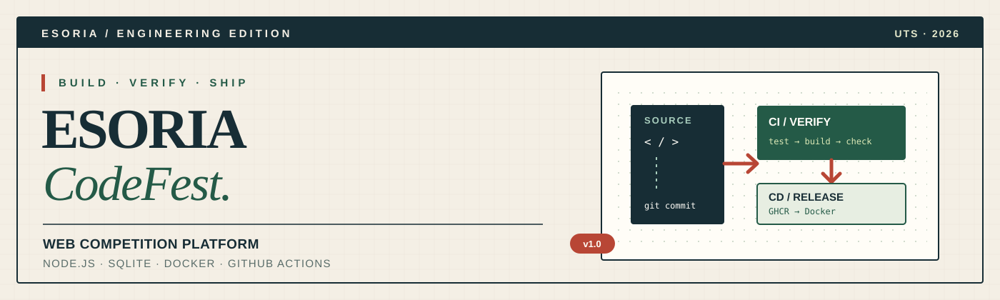
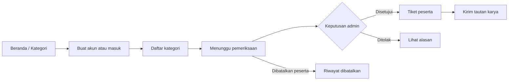
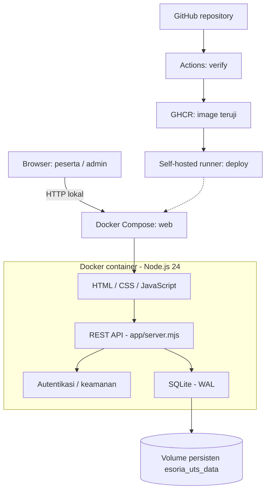
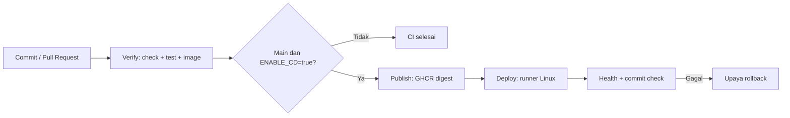

<p align="center">
  
</p>

<p align="center"><strong>Aplikasi pengelolaan kompetisi pemrograman, dikemas dalam container dan didukung pipeline CI/CD.</strong></p>
<p align="center">Edisi UTS Pengembangan dan Operasi · Universitas Mikroskil · 2026</p>
<p align="center">
  <a href="https://nodejs.org/"></a>
  <a href="https://www.docker.com/"></a>
  <a href="https://sqlite.org/"></a>
  <a href="https://github.com/fikriianwarr/esoria-codefest-uts/actions"></a>
</p>
<p align="center">
  <a href="#quick-start"><strong>Mulai Menjalankan</strong></a> · <a href="#fitur"><strong>Fitur Website</strong></a> · <a href="#arsitektur"><strong>Arsitektur</strong></a> · <a href="#cicd"><strong>CI/CD</strong></a> · <a href="#pengujian"><strong>Pengujian</strong></a> · <a href="#tim"><strong>Tim</strong></a>
</p>

---

## 01 / Tentang ESORIA CodeFest

**ESORIA CodeFest** adalah website untuk mengelola alur kompetisi dari pemilihan kategori, pembuatan akun dan pendaftaran peserta, pemeriksaan pendaftaran oleh panitia, hingga penerbitan tiket dan pengiriman tautan karya. Antarmukanya bergaya *paper editorial*: latar krem, tipografi tegas, aksen hijau tua dan merah bata, serta tata letak responsif untuk desktop maupun perangkat seluler.

Edisi pada repository ini merupakan **adaptasi mandiri untuk UTS mata kuliah Pengembangan dan Operasi**, dengan fokus pada permasalahan *deployment* yang cepat, dapat diulang, dan terverifikasi. Seluruh alur demonstrasi berjalan pada **Node.js, HTTP API, dan SQLite** di dalam container Docker; karena itu, paket ini **bukan salinan seluruh fitur platform ESORIA berbasis Firebase sebelumnya**. Penjelasan asal pengembangan terdapat di [`docs/SUMBER.md`](docs/SUMBER.md).

> [!IMPORTANT]
> **Lingkungan demonstrasi akademik.** Biaya kategori dan referensi pembayaran adalah **data simulasi**, bukan instruksi membayar. Aplikasi tidak memproses transfer uang sungguhan, tidak mengunggah bukti pembayaran, dan tidak menyelenggarakan penjurian/CTF otomatis.

### Ringkasan proyek

| Area | Implementasi |
|:--|:--|
| **Jenis aplikasi** | Website kompetisi + REST API, satu origin |
| **Runtime** | Node.js 24.22.1 atau versi 24 yang lebih baru; JavaScript ES Modules |
| **Frontend** | HTML5, CSS3, dan JavaScript native, tanpa framework UI |
| **Data** | SQLite (`node:sqlite`), mode WAL, di Docker named volume |
| **Container** | Dockerfile multi-stage, Docker Compose v2, image runtime non-root |
| **Integrasi & rilis** | GitHub Actions → GitHub Container Registry (GHCR) → self-hosted runner |
| **Versi aplikasi** | `1.0.0` |
| **Repository** | [`fikriianwarr/esoria-codefest-uts`](https://github.com/fikriianwarr/esoria-codefest-uts) |

<a id="fitur"></a>

## 02 / Fitur utama website

| Modul | Peserta | Admin / panitia |
|:--|:--|:--|
| **Akun & sesi** | Daftar akun, masuk, keluar, ubah profil dan institusi | Masuk menggunakan akun admin dari `.env` privat |
| **Kategori kompetisi** | Melihat deskripsi, jadwal, kuota, dan biaya simulasi | Mengubah judul, uraian, jadwal, kuota, biaya, dan status kategori |
| **Pendaftaran** | Daftar kategori individu atau tim 2–4 orang; isi referensi pembayaran latihan | Meninjau pendaftaran masuk dan melihat detail referensi simulasi |
| **Status pendaftaran** | Melihat status `pending`, `approved`, `rejected`, atau `cancelled`; membatalkan saat masih `pending` | Menyetujui atau menolak pendaftaran yang masih `pending` (penolakan memerlukan alasan) |
| **Tiket peserta** | Melihat tiket setelah disetujui dan mencetak/menyimpannya sebagai PDF lewat browser | Melihat identitas tiket pada daftar pendaftaran |
| **Pengiriman karya** | Menyimpan atau memperbarui tautan HTTPS setelah disetujui, sebelum tenggat | Melihat data karya yang tercatat pada pendaftaran |
| **Pemantauan** | Dashboard ringkasan dan riwayat pendaftaran | Statistik, pencarian/filter status, 80 jejak aktivitas terbaru, dan halaman operasional |

**Aturan penting:** satu akun hanya dapat memiliki **satu pendaftaran per kategori**; pembatalan hanya tersedia saat status masih `pending`, dan kategori tim berisi seorang ketua akun + **1–3 anggota tambahan**. Aplikasi memeriksa periode pendaftaran dan kuota di sisi server, bukan hanya melalui tampilan browser.

### Tiga kategori bawaan

Kategori berikut dibuat otomatis saat database masih kosong; **admin dapat memperbarui data kategori sesudahnya**.

| Kategori | Format | Biaya simulasi | Kuota awal |
|:--|:--|--:|--:|
| **Website Programming** | Individu | Rp150.000 | 50 |
| **Cybersecurity Mini CTF** | Individu | Rp150.000 | 50 |
| **Full Stack Development** | Tim 2–4 orang | Rp500.000 / tim | 25 tim |

### Alur penggunaan



### Halaman yang tersedia

| Halaman | Rute | Fungsi |
|:--|:--|:--|
| Beranda | `/` | Pengenalan CodeFest dan kategori |
| Kategori | `/kategori` | Informasi kategori, jadwal, dan kuota |
| Panduan | `/panduan` | Tata cara dan batasan edisi UTS |
| Buat akun / Masuk | `/buat-akun` · `/masuk` | Registrasi dan autentikasi akun lokal |
| Dashboard peserta | `/dashboard` | Status, riwayat, dan tindakan pendaftaran |
| Formulir pendaftaran | `/daftar` | Pilih kategori serta isi data individu/tim |
| Profil | `/profil` | Informasi identitas akun |
| Tiket | `/tiket?id=...` | Tiket pendaftaran yang telah disetujui |
| Dashboard admin | `/admin` | Pendaftaran, kategori, dan jejak aktivitas |
| Operasional admin | `/operasional` | Kesehatan layanan, database, dan identitas rilis |

Akses halaman dan API dibatasi berdasarkan sesi dan peran; rute peserta/admin tidak dapat digunakan tanpa otorisasi yang sesuai.

<a id="arsitektur"></a>

## 03 / Arsitektur sistem



> **Catatan diagram:** panah putus-putus menggambarkan jalur deployment CI/CD pada mesin tujuan, bukan bahwa GitHub mengubah container lokal setiap kali sebuah branch baru di-push.

- **Satu origin:** Node.js melayani aset frontend dan `/api/*` pada port **3000 di dalam container**.
- **Database persisten:** `esoria.sqlite` disimpan di `/app/data` melalui volume bernama **`esoria_uts_data`**, sehingga restart/recreate container tidak otomatis menghapus data.
- **Isolasi runtime:** image dibangun dengan tahap `verify` dan `runtime`; server berjalan sebagai pengguna `node` non-root, *read-only root filesystem*, `tmpfs`, `cap_drop`, dan batas CPU/memori.
- **Keamanan aplikasi:** hashing kata sandi dengan `scrypt`, cookie sesi HttpOnly dan SameSite, pemeriksaan token CSRF, validasi input, perlindungan API berbasis peran, pembatasan percobaan, dan Content Security Policy.

<a id="quick-start"></a>

## 04 / Quick start — jalankan website

### Persyaratan

| Perangkat lunak | Keterangan |
|:--|:--|
| Windows 10/11 | Untuk launcher satu klik `mulai.cmd` |
| Docker Desktop | Aktif, menggunakan **Linux containers** |
| Docker Compose | Versi 2 (`docker compose`) |
| Node.js | **24.22.1+ dalam lini Node 24** (bukan Node 22) |
| Git | Hanya diperlukan untuk pengiriman source ke GitHub |

### Cara termudah di Windows

1. **Ekstrak** berkas ZIP proyek ke folder biasa, misalnya `C:\Users\fikri\Downloads\esoria_codefest_uts`.
2. Jalankan **Docker Desktop** hingga engine siap.
3. Dari folder proyek, klik dua kali **`mulai.cmd`** atau jalankan perintah di bawah.
4. Launcher mempersiapkan `.env` lokal bila belum tersedia, memilih port host yang kosong, membangun image, menunggu *healthcheck*, lalu membuka website.

```powershell
cd "C:\Users\fikri\Downloads\esoria_codefest_uts"
.\mulai.cmd
```

**Alamat akses:** `http://localhost:8080` apabila port 8080 tersedia; bila port itu dipakai, launcher akan mencari port alternatif mulai dari **8088**. **Gunakan URL yang dicetak launcher**, bukan menganggap port selalu sama.

**Akun admin awal:** email `admin@esoria.test` untuk instalasi baru. Kata sandi admin dihasilkan secara acak dan disimpan hanya di **`.env` lokal**, bukan di README atau GitHub. Buka `.env` secara privat untuk melihat `ADMIN_PASSWORD`; jangan tampilkan nilainya saat merekam video.

> [!CAUTION]
> **Jangan hapus database saat memperbarui aplikasi.** Hindari `docker compose down -v` dan jangan mengunggah `.env`. Jika volume lama masih ada dan `.env` hilang, ikuti [panduan pemulihan aman](#troubleshooting), jangan membuat kata sandi sembarang atau menghapus volume.

### Pemeriksaan endpoint (PowerShell)

Setelah website berjalan, **tentukan `$BASE` dalam jendela PowerShell yang sama** sebelum menjalankan `curl.exe`. Bila aplikasi berjalan pada port 8088:

```powershell
$BASE = "http://127.0.0.1:8088"
curl.exe -fsS "$($BASE)/api/health"
curl.exe -fsS "$($BASE)/api/release"
```

Contoh *struktur* respons `/api/health`:

```json
{
  "status": "ok",
  "app": "esoria-uts",
  "database": "ok",
  "uptimeSeconds": 123
}
```

Angka `uptimeSeconds` bergantung pada lama aplikasi berjalan. Endpoint `/api/release` mengembalikan `version`, `commit`, dan `appName`; image dari `mulai.cmd` biasanya mengembalikan `commit: "local"`, **bukan SHA GitHub Actions**.

Untuk mendeteksi port aktif otomatis, gunakan perintah berikut setelah Docker Compose hidup:

```powershell
$PORT = ((docker compose port web 3000 | Select-Object -First 1) -split ':')[-1].Trim()
$BASE = "http://127.0.0.1:$PORT"
curl.exe -fsS "$($BASE)/api/health"
```

<a id="pengujian"></a>

## 05 / Pengujian & bukti verifikasi

**Perintah singkat yang disediakan paket:**

| Perintah | Kegunaan |
|:--|:--|
| `.\PERIKSA-BUKTI.cmd` | Cek container, endpoint, dan bukti runtime tanpa build ulang penuh |
| `.\PERIKSA-SEMUA.cmd` | Menjalankan launcher dan rangkaian pemeriksaan UTS |
| `npm run check` | Memeriksa source dan aset |
| `npm test` | Menjalankan suite pengujian otomatis |
| `npm run check:docker` | Memeriksa aplikasi Docker yang sedang berjalan |
| `npm run verify:container:windows` | Uji image/container, smoke test, restart/recreate, dan persistensi pada volume uji terpisah |
| `.\lihat-audit.ps1` | Membaca audit JSON lokal terbaru tanpa mengetik pipeline `Sort-Object` |
| `.\cek-bukti.ps1` | Memeriksa audit, HTTP, dan identitas runtime |

```powershell
# Jalankan dari root proyek setelah Docker Desktop aktif.
.\PERIKSA-SEMUA.cmd

# Atau pengujian terpisah:
npm run check
npm test
docker compose ps
npm run check:docker
```

**Bukti historis dalam laporan Word:** 81/81 pengujian lulus serta GitHub Actions **Run #2** (27 Oktober 2026) dengan job `verify`, `publish`, dan `deploy` berhasil pada commit `5fe69f9`. **ZIP tanggal 30 Oktober memuat berkas pengujian tambahan** sehingga jumlah hasil `npm test` versi terbaru **tidak harus 81**; gunakan output tes aktual yang dijalankan pada revisi ini, bukan memindahkan angka laporan secara otomatis.

Tautan referensi historis: [**GitHub Actions Run #2**](https://github.com/fikriianwarr/esoria-codefest-uts/actions/runs/40434638852). Ini adalah **bukti run sebelumnya**, bukan klaim bahwa setiap commit/branch terbaru telah melewati deployment.

Lihat [`docs/VERIFIKASI_POWERSHELL.md`](docs/VERIFIKASI_POWERSHELL.md) dan [`docs/PERINTAH_WINDOWS_FINAL_SIAP_SALIN.md`](docs/PERINTAH_WINDOWS_FINAL_SIAP_SALIN.md) untuk perintah lengkap, troubleshooting, dan pengambilan bukti UTS.

<a id="cicd"></a>

## 06 / Pipeline CI/CD

Alur di `.github/workflows/esoria-ci-cd.yml` menggunakan **tiga tahap**:

| Tahap | Yang dikerjakan | Kondisi |
|:--|:--|:--|
| **01 — Verify** | Instalasi dari lockfile, pemeriksaan source, tes otomatis, build dan smoke test image | Pull Request, push `main`, atau `workflow_dispatch` |
| **02 — Publish** | Publikasi **image yang telah diuji** ke GitHub Container Registry, dicatat menurut digest | Branch `main`, `ENABLE_CD=true`, dan bukan event PR |
| **03 — Deploy** | Self-hosted runner Linux menjalankan image dari digest, memeriksa health dan SHA rilis; terdapat upaya rollback bila gagal | Setelah `publish` sukses dan CD diaktifkan |



**Aktivasi CD bukan otomatis untuk semua branch.** GitHub Actions memerlukan Repository Variables `ENABLE_CD=true`, `ESORIA_APP_PORT`, `ESORIA_BIND_ADDRESS`, `ESORIA_COOKIE_SECURE`, serta Repository Secrets `ESORIA_ADMIN_EMAIL` dan `ESORIA_ADMIN_PASSWORD` ketika deployment dipakai. Runner perlu memiliki label `self-hosted`, `Linux`, `X64`, dan `esoria-uts`. **Penggabungan Pull Request ke `main` dapat memicu deployment** jika konfigurasi CD sedang aktif; periksa pengaturan sebelum merge.

Dokumentasi pengaturan, runner WSL2, GHCR, pemeriksaan rilis, dan rollback: [`docs/CI_CD.md`](docs/CI_CD.md). Workflow: [**Lihat konfigurasi GitHub Actions**](.github/workflows/esoria-ci-cd.yml).

### Upload update proyek ke GitHub tanpa force push

Skrip `upload-esoria-github.ps1` mengkloning repository lalu mengirim perubahan ke **branch baru** secara default (bukan `main`), untuk ditinjau sebelum membuat Pull Request. Gunakan Git for Windows dan autentikasi akun yang mempunyai akses repository.

```powershell
powershell.exe -NoProfile -ExecutionPolicy Bypass -File ".\upload-esoria-github.ps1" -SourceFolder "."
```

Setelah selesai, buka tautan Pull Request yang dicetak skrip. **Upload ke branch bukan bukti deployment**; pengujian dan proses merge masih perlu diperiksa.

## 07 / Struktur direktori

```text
esoria_codefest_uts/
├── README.md                      # Dokumentasi utama GitHub
├── docs/
│   ├── assets/readme-banner.svg   # Sampul README
│   ├── CI_CD.md                   # GHCR, runner, secrets, deploy/rollback
│   ├── ANALISIS_RUBRIK.md         # Pemetaan kebutuhan UTS
│   ├── SUMBER.md                  # Asal pengembangan aplikasi
│   ├── VERIFIKASI_POWERSHELL.md   # Audit dan perintah pemeriksaan
│   └── PERINTAH_WINDOWS_FINAL_SIAP_SALIN.md
├── app/
│   ├── server.mjs                 # HTTP server / REST API
│   ├── database.mjs               # SQLite + seed kategori
│   ├── security.mjs               # Validasi, sesi, otorisasi
│   └── public/                    # HTML, CSS, JS, logo dan favicon
├── scripts/                       # Setup, check, deploy, rollback
├── tests/                         # Tes aplikasi, keamanan, Docker, CD
├── .github/workflows/             # GitHub Actions
├── Dockerfile                     # Multi-stage verify → runtime
├── compose.yaml                   # Docker Compose lokal
├── compose.deploy.yaml            # Compose untuk image rilis GHCR
├── mulai.cmd                      # Launcher Windows
├── PERIKSA-BUKTI.cmd               # Pemeriksaan bukti cepat
├── PERIKSA-SEMUA.cmd               # Pemeriksaan lengkap
├── upload-esoria-github.ps1        # Push branch GitHub secara aman
├── .env.example                   # Template tanpa kredensial asli
└── package.json                   # Perintah npm dan versi runtime
```

## 08 / Keamanan & batasan implementasi

<details>
<summary><strong>Yang sudah diimplementasikan</strong></summary>

- Cookie sesi HttpOnly dan SameSite, validasi asal permintaan dan token CSRF untuk operasi yang mengubah data.
- Kontrol akses berdasarkan peran `participant` dan `admin`; hashing kata sandi `scrypt` dan validasi server.
- Database pada named volume, root filesystem container *read-only*, proses non-root, dan kebijakan healthcheck.
- Pencatatan audit untuk aktivitas akun, pendaftaran, moderasi, dan perubahan kategori.
- Pemeriksaan image, identitas release, dan prosedur rollback pada jalur CD.

</details>

<details>
<summary><strong>Yang bukan fitur pada edisi UTS ini</strong></summary>

Tidak tersedia pembayaran nyata atau *payment gateway*, unggah screenshot transfer, OTP/verifikasi email, Google login, pemulihan sandi lewat email, notifikasi push, modul juri/penjurian, mesin CTF interaktif, sertifikat, maupun layanan Firebase produksi. Tiket yang dicetak adalah **dokumen latihan**, bukan bukti penerimaan dana. Jangan memasukkan kredensial pribadi atau transaksi nyata saat demonstrasi.

</details>

<a id="troubleshooting"></a>

## 09 / Troubleshooting singkat

| Kendala | Pemeriksaan yang disarankan |
|:--|:--|
| `curl: (3) URL rejected: No host part` | Isi `$BASE` pada jendela PowerShell aktif, misalnya `$BASE = "http://127.0.0.1:8088"`, lalu ulangi `curl.exe -fsS "$($BASE)/api/health"`. |
| `Node.js` tidak cocok | Instal Node **24.22.1+ dalam lini 24**, lalu buka ulang terminal. |
| Container belum sehat | `docker compose ps`, lalu `docker compose logs --tail 60 web`. |
| Port 8080 digunakan aplikasi lain | Jalankan `mulai.cmd` dan ikuti port pengganti yang dipilih; periksa `docker compose port web 3000`. |
| `.env` hilang, sedangkan database lama ada | **Jangan hapus volume.** Jalankan `mulai.cmd` untuk mencoba pemulihan dari container ESORIA sebelumnya yang terverifikasi; jika gagal, salin `.env` asli. Hanya jika kredensial tidak bisa dipulihkan, jalankan secara sadar `npm run recover:admin:local` untuk menyinkronkan ulang admin lokal. |
| Salah membaca audit JSON | Pakai `.\lihat-audit.ps1` alih-alih menyalin `Sort-Object` secara terpotong. |
| Image lokal ditolak saat dicek terhadap SHA GitHub | Gunakan `node scripts/check-runtime.mjs --expected-release local` untuk rilis lokal. Pengecekan `--expected-sha` khusus image yang benar-benar dibangun dari commit tersebut. |
| Ingin menghentikan container | Jalankan `docker compose down` **tanpa `-v`** agar volume database tetap ada. |

> [!WARNING]
> Berkas `.env`, kata sandi admin, token, cookie, dan hasil `docker inspect` yang memuat variabel lingkungan tidak boleh diunggah ke repository atau ditampilkan dalam tangkapan layar UTS.

<a id="tim"></a>

## 10 / Tim pengembang

**Kelompok Esoria — Universitas Mikroskil**  
Mata kuliah **Pengembangan dan Operasi** · Kelas **IF-B Pagi, TA 2026/2027**  
Dosen pengampu **Sunario Megawan, S.Kom., M.Kom.**

| Anggota | NIM | Fokus kontribusi dalam laporan UTS |
|:--|:--|:--|
| **Fikri Anwar** | `231112145` | Container Docker, Dockerfile, Compose, launcher, port, volume, dan healthcheck |
| **Muhammad Alfisyahrin** | `231112853` | Pipeline GitHub Actions, GHCR, runner Linux/WSL2, deployment dan rollback |
| **Havidz Andrian** | `231111899` | Pengujian, verifikasi health/release, persistensi SQLite, dokumentasi dan bukti |

Pembagian ini mengacu pada laporan kelompok dan merupakan **ruang lingkup penjelasan**, bukan klaim kepemilikan commit per individu.

### Dokumentasi dan referensi

| Sumber | Tautan |
|:--|:--|
| Repository | [GitHub ESORIA CodeFest UTS](https://github.com/fikriianwarr/esoria-codefest-uts) |
| Workflow | [`.github/workflows/esoria-ci-cd.yml`](.github/workflows/esoria-ci-cd.yml) |
| Bukti CI/CD historis | [GitHub Actions Run #2 — 27 Oktober 2026](https://github.com/fikriianwarr/esoria-codefest-uts/actions/runs/40434638852) |
| Petunjuk CI/CD | [`docs/CI_CD.md`](docs/CI_CD.md) |
| Perintah Windows & audit | [`docs/PERINTAH_WINDOWS_FINAL_SIAP_SALIN.md`](docs/PERINTAH_WINDOWS_FINAL_SIAP_SALIN.md) |
| Pemetaan rubrik | [`docs/ANALISIS_RUBRIK.md`](docs/ANALISIS_RUBRIK.md) |
| Asal & ruang lingkup adaptasi | [`docs/SUMBER.md`](docs/SUMBER.md) |

---

<p align="center"><strong>ESORIA CODEFEST</strong><br /><em>Build with purpose. Compete with character.</em></p>
<p align="center"><sub>Academic containerization &amp; CI/CD case study · 2026 · Dokumentasi source dan implementasi, bukan layanan kompetisi berbayar.</sub></p>
